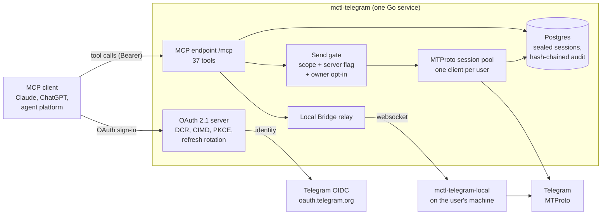

# mctl-telegram

[](https://github.com/mctlhq/mctl-telegram/actions/workflows/build.yml)
[](https://github.com/mctlhq/mctl-telegram/actions/workflows/codeql.yml)
[](https://securityscorecards.dev/viewer/?uri=github.com/mctlhq/mctl-telegram)
[](https://github.com/mctlhq/mctl-telegram/releases)
[](LICENSE)

A remote MCP server that gives AI assistants access to a user's own
Telegram account: read dialogs and messages, search, and send only when
the user has explicitly allowed it. It runs in production at
`https://tg.mctl.ai/mcp`. Claude is the client we test against —
claude.ai, the desktop and mobile apps, and Claude Code — and ChatGPT can
add it by URL. It is a standard remote MCP server with OAuth, so other
clients such as Cursor, VS Code and Windsurf may work, but they are not
yet tested against tg.mctl.ai. Agent platforms can also connect on behalf
of their users.

Written in Go on [`gotd/td`](https://github.com/gotd/td) (MTProto) and
[`mcp-go`](https://github.com/mark3labs/mcp-go), with its own OAuth 2.1
authorization server that signs users in with Telegram.

mctl-telegram is an independent project, not an official Telegram app or
Telegram API partner. It operates only on the Telegram account that the
user explicitly connects and controls; users remain responsible for
complying with Telegram's terms. Status: v0.x; tool schemas may change
before v1.0.

## What it does

- **For a user:** connect the account once from a browser, then ask an
  assistant to summarize unread chats, find a message, or draft and send a
  reply. Accounts start read-only; sending is a separate opt-in, and every
  call lands in an audit log the user can read and verify.
- **For an agent platform:** a standard OAuth 2.1 server with Dynamic
  Client Registration and Client ID Metadata Documents. With CIMD a
  platform describes its own redirect URIs, so one approved host covers
  all of its users; the operator still has to allow that host once. Users who
  will not leave their Telegram session on a server can run it on their
  own machine with [Local Bridge](#local-bridge-daemon-cmdlocal-beta) and
  keep the same endpoint.

## Architecture



- The client discovers the authorization server from
  `/.well-known/oauth-protected-resource` (RFC 9728), registers, and sends
  the user to sign in with Telegram. The service issues its own tokens.
- A tool call is checked against the token's scopes, run on the user's
  MTProto client from the pool, and recorded in the user's audit chain.
  Writes also pass the send gate.
- For a Local Bridge account the call goes down a websocket to the user's
  own daemon instead, and the server only relays.

| Path | Purpose |
|---|---|
| `/mcp` | MCP Streamable HTTP endpoint. Auth: `Authorization: Bearer <JWT>`. A 401 carries `WWW-Authenticate` pointing to `/.well-known/oauth-protected-resource/mcp`. |
| `/.well-known/oauth-protected-resource` | RFC 9728 metadata naming the authorization server. |
| `/.well-known/oauth-authorization-server` | RFC 8414 metadata: authorize, token, register, revoke. |
| `/healthz`, `/readyz` | Probes, `ok` 200. |
| `/`, `/docs`, `/security`, `/privacy`, `/terms` | Public pages. |

## Design decisions

The reasoning behind the architecture is recorded as
[architecture decision records](docs/adr/README.md), each with the code
that carries it and what it costs:

| ADR | Decision |
|---|---|
| [0001](docs/adr/0001-per-user-session-keys.md) | Sessions sealed with per-user keys, and the hosted mode stated as not zero-knowledge |
| [0002](docs/adr/0002-send-gate.md) | One send gate with three independent conditions; accounts start read-only |
| [0003](docs/adr/0003-hash-chained-audit-log.md) | A per-user hash-chained audit log; logs redacted by a handler |
| [0004](docs/adr/0004-own-authorization-server.md) | Its own OAuth 2.1 server, brokering Telegram's OpenID Connect sign-in |
| [0005](docs/adr/0005-session-pool-and-sticky-routing.md) | A per-pod session pool, one replica, sticky routing built and tested |
| [0006](docs/adr/0006-local-bridge-relay.md) | Local Bridge: the session stays on the user's machine |
| [0007](docs/adr/0007-tool-surface-as-contract.md) | The tool surface as a reviewed contract with a release gate |

## Engineering

- About 68,000 lines of Go, and more test code than that (about 82,000
  lines in 295 test files).
- CI runs the whole module under `go test -race` against a real Postgres,
  plus tests on macOS and Windows, `govulncheck`, CodeQL and OpenSSF
  Scorecard. Actions are pinned by commit SHA.
- A release cannot change the tool surface without an approved
  product-update entry ([ADR 0007](docs/adr/0007-tool-surface-as-contract.md)).
- Sticky routing for more than one replica is proven by an acceptance
  workflow on kind, against ingress-nginx and Istio.
- Service-level objectives with burn-rate alerts ([docs/slo.md](docs/slo.md))
  and a synthetic canary that checks OAuth discovery and a read-only tool
  call every ten minutes.

## Security and privacy model

mctl-telegram holds a **server-side** Telegram MTProto session on your
behalf. The server can technically read your Telegram data while
processing your requests, because it is the one making MTProto calls to
Telegram. It stores only the session, sealed with a per-user key, and logs
no message text and no phone numbers; but you are trusting both the
operator of this deployment and the integrity of this code. Local Bridge
exists for users who will not.

See [SECURITY.md](SECURITY.md) for the full threat model, cryptographic
invariants, send-gate design, OAuth rules and reporting channel.

**Do not expose this server publicly without OAuth, HTTPS, and a trusted
deployment boundary.**

## Connecting a client

### Hosted endpoint (`tg.mctl.ai`)

- **Claude:** Settings → Connectors → Add custom connector, URL
  `https://tg.mctl.ai/mcp`. Sign in with Telegram when the browser opens.
- **ChatGPT:** add a custom MCP server by URL in ChatGPT on the web (under
  Settings → Apps; some plans need Developer Mode turned on first) and
  choose OAuth. MCTL is not listed in the ChatGPT app directory; the by-URL
  path is the supported one.
- **Cursor, VS Code, Windsurf and others** (not yet tested): use
  `https://tg.mctl.ai/mcp`; the client discovers OAuth from the well-known
  metadata. None of these has a verified sign-in against tg.mctl.ai, so
  treat this as a starting point. A `cursor://` redirect is refused today
  (only `https` and loopback redirects are accepted), so Cursor sign-in may
  fail.
- **Agent platforms:** register with Dynamic Client Registration from a
  callback host on the allowlist, or publish a Client ID Metadata Document
  on your own domain and ask for your host to be added. The integration
  guide is at [tg.mctl.ai/platforms](https://tg.mctl.ai/platforms); see
  [SECURITY.md](SECURITY.md) for the exact redirect rules.

The first connection asks which permissions to grant. "Read only" is the
default; sending can be turned on later on the account page
(`https://tg.mctl.ai/telegram/connect/manage`) or with the `set_send_consent` tool. If an error comes
back, [docs/troubleshooting.md](docs/troubleshooting.md) explains the error
families clients actually hit.

### Your own deployment

1. Confirm discovery is reachable:
   `curl https://<your-host>/.well-known/oauth-protected-resource`, then
   follow the `authorization_servers` URL it names and fetch its
   `/.well-known/oauth-authorization-server`. In `local-jwt` mode that is
   your own host; in the `shared-hmac` modes it is
   `https://api.mctl.ai`.
2. Add `https://<your-host>/mcp` as a custom connector in your client, with
   OAuth.
3. Run `initialize` and one read-only tool call (MCP Inspector works)
   before relying on it. Real sends stay off until `ALLOW_SEND=true`, the
   token has the send scope, and the account owner opts in.

## MCP tools

The authoritative list is `docs/tool-descriptors.json` (37 tools, regenerated by `go test ./internal/mcp -update-descriptors`): 10 read tools, 9 message write tools (`prepare_send_message`, `send_message`, `send_media`, `edit_message`, `delete_messages`, `forward_messages`, `set_reaction`, `prepare_pin_message`, `pin_message`), 5 own-account tools (`set_send_consent`, `set_my_notification_preferences`, `revoke_local_bridge_device`, `disconnect_telegram_account`, `delete_telegram_account`), 9 admin tools and 4 broadcast-operator tools. The table below describes the ones most clients use:

| Tool                          | MCP annotations | Notes |
|-------------------------------|----------------------|-------|
| `list_dialogs`                | `readOnly=true`, `destructive=false`, `openWorld=true` | Reads Telegram dialogs (audit row is internal observability). Inputs: `limit` (≤200, default 50), optional `query`. |
| `get_unread_messages`         | `readOnly=true`, `destructive=false`, `openWorld=true` | Reads unread Telegram messages (audit row is internal observability). Inputs: optional `peer`, `limit` (≤200). When `peer` is omitted, DMs and chats/groups (including megagroup/supergroups) fill `limit` before broadcast channels. |
| `get_messages`                | `readOnly=true`, `destructive=false`, `openWorld=true` | Reads recent message history for a specific peer (audit row is internal observability). |
| `search_messages`             | `readOnly=true`, `destructive=false`, `openWorld=true` | Searches Telegram messages by text query, newest-first. Inputs: `query`, optional `peer`, `limit` (default 20, max 100), `min_date`/`max_date` (inclusive UTC bounds, RFC 3339 or plain `YYYY-MM-DD`) to bound the search to a time window. |
| `send_message`                | `readOnly=false`, `destructive=true`, `openWorld=true` | Inputs: `peer`, `text`. Preview-only by default: sends for real only when the gate is fully open (server `ALLOW_SEND=true`, identity has `telegram:messages:send` scope, per-account `send_enabled=true`). Otherwise returns `sent=false` with `dry_reason`; no message is delivered. |
| `send_media`                  | `readOnly=false`, `destructive=true`, `openWorld=true` | Inputs: `peer`, `media_type` (`photo`/`video`/`document`/`animation`), exactly one of `file_url`/`file_base64`, optional `caption`/`file_name` (required for `document`+`file_base64`). Same preview-only gate as `send_message`; a denied call never fetches `file_url` or decodes `file_base64`. `animation` is always sent as a distinct type from `video`, never relabeled. `file_url` goes through an SSRF-guarded fetcher (HTTPS-only; loopback/link-local/private-range addresses refused, including on redirect hops). Both sources are capped by `MEDIA_UPLOAD_MAX_BYTES` (default 20 MiB). |
| `prepare_pin_message`         | `readOnly=false`, `destructive=false`, `openWorld=false` | Creates a local one-shot confirmation record for a later `pin_message` call. |
| `pin_message`                 | `readOnly=false`, `destructive=true`, `openWorld=true` | Pins or unpins a Telegram message after a matching confirmation id. |
| `get_my_audit_log`            | `readOnly=true`, `destructive=false`, `openWorld=false` | Returns the authenticated user's own audit rows. |
| `get_my_send_status`          | `readOnly=true`, `destructive=false`, `openWorld=false` | Reports whether `send_message` would deliver for real, without sending. Returns `can_send`, the blocking `reason`, and the three gate conditions separately (`server_allow_send`, `has_send_scope`, `send_enabled`) plus `connected`. The verdict comes from the same gate `send_message` consults, so the two cannot disagree. The per-peer rate limit is not evaluated (it depends on a recipient and checking it would spend that recipient's budget). |
| `disconnect_telegram_account` | `readOnly=false`, `destructive=true`, `openWorld=false` | Soft-revokes your session and tears down the in-memory MTProto client. Requires `account:manage`; on deployments with the Telegram manage page enabled, the browser manage page (`/telegram/connect/manage`) disconnects without it. |
| `delete_telegram_account`     | `readOnly=false`, `destructive=true`, `openWorld=false` | Hard-deletes the encrypted session blob and per-account metadata from this server. Requires `account:manage`. |
| `list_telegram_identities`    | `readOnly=true`, `destructive=false`, `openWorld=false` | Admin-only: lists signed-in Telegram identities and access state, with audit metadata. |
| `set_telegram_access`         | `readOnly=false`, `destructive=true`, `openWorld=false` | Admin-only: grants or revokes the local client access tier for a Telegram user. |
| `set_account_send`            | `readOnly=false`, `destructive=true`, `openWorld=false` | Admin-only: enables or disables the per-account real-send gate. |
| `get_user_audit_log`          | `readOnly=true`, `destructive=false`, `openWorld=false` | Admin-only: reads another Telegram user's audit rows, with audit metadata. |
| `revoke_telegram_session`     | `readOnly=false`, `destructive=true`, `openWorld=false` | Admin-only: revokes a user's active MTProto session on this server. |
| `prepare_broadcast`           | `readOnly=false`, `destructive=false`, `openWorld=false` | Broadcast operators only (`admin:broadcast` = platform admin AND `BROADCAST_OPERATORS`). Previews a broadcast to opted-in clients and records it as a prepared campaign; sends nothing. Returns the eligible/skipped counts and an `approval_url`. **No tool can approve**: a human operator approves on `/telegram/connect/broadcasts`, signed in with Telegram in a browser. See [docs/runbook.md](docs/runbook.md#broadcast-delivery-issue-439). |
| `list_broadcasts`             | `readOnly=true`, `destructive=false`, `openWorld=false` | Broadcast operators only: lists campaigns, optionally by state. |
| `get_broadcast`               | `readOnly=true`, `destructive=false`, `openWorld=false` | Broadcast operators only: one campaign plus its aggregate delivery report (no recipients named). |
| `cancel_broadcast`            | `readOnly=false`, `destructive=true`, `openWorld=false` | Broadcast operators only: cancels a campaign that has not finished; unsent messages are skipped. |

## MCP Apps (prototype, flag-gated)

Set `MCP_APPS_ENABLED=true` to expose a flag-gated MCP Apps (SEP-1865) research/triage App, served inline from `internal/mcpui` as a `ui://` resource; off by default, so the surface above is unchanged unless you opt in. See [docs/reports/mcp-apps-spike.md](docs/reports/mcp-apps-spike.md) for the full design, threat model and host-compatibility evidence.

## Quick start (local dev)

```bash
# 1. Build & run the server (auth bypassed for local dev)
ADDR=127.0.0.1:8080 \
AUTH_MODE=local-dev AUTH_REQUIRED=false \
OPERATOR_GITHUB_LOGIN=your-github-handle \
DATABASE_URL='file:./mctl-telegram.db?_pragma=journal_mode(WAL)' \
go run ./cmd/server

# 2. First-time login (register an app at https://my.telegram.org first)
TG_API_ID=12345 TG_API_HASH=hexhexhex... \
DATABASE_URL='file:./mctl-telegram.db?_pragma=journal_mode(WAL)' \
OPERATOR_GITHUB_LOGIN=your-github-handle \
go run ./cmd/login --phone +1...

# 3. Smoke test via MCP inspector or curl
curl -s -X POST localhost:8080/mcp \
  -H "Content-Type: application/json" \
  -H "Accept: application/json, text/event-stream" \
  -d '{"jsonrpc":"2.0","id":1,"method":"initialize","params":{"protocolVersion":"2025-03-26","capabilities":{},"clientInfo":{"name":"local","version":"0"}}}'
```

## Self-hosted deployment

### Prerequisites

- Telegram API credentials: register an app at <https://my.telegram.org> to get `TG_API_ID` and `TG_API_HASH`.
- A Telegram bot for the OIDC login flow: create one via BotFather and note its numeric id and token.
- A Postgres database (or SQLite for single-node deployments).
- An HTTPS endpoint reachable by your MCP clients.

### Configuration

Copy `.env.example` to `.env` and fill in the values:

```bash
cp .env.example .env
$EDITOR .env
```

Key variables:

| Variable                      | Description                                                                 |
|-------------------------------|-----------------------------------------------------------------------------|
| `AUTH_MODE`                   | `local-jwt` — server signs its own tokens (recommended for self-hosting)    |
| `AUTH_REQUIRED`               | `true` in production; `false` only for local dev                            |
| `OAUTH_JWT_SIGNING_KEY`       | HS256 signing key for access tokens; see below                              |
| `TELEGRAM_OIDC_CLIENT_ID`     | Login bot's numeric Telegram id (from BotFather; not secret)                |
| `TELEGRAM_OIDC_CLIENT_SECRET` | OIDC client secret for the login bot                                        |
| `TELEGRAM_LOGIN_BOT_TOKEN`    | Bot token — used only for the new-client welcome digest                     |
| `TELEGRAM_LOGIN_BOT_USERNAME` | Optional. Login bot @username for the `t.me` start link on the connect success and manage pages (issue-679). Not the 0.16.0 widget variable of the same name, which was removed (see CHANGELOG 0.16.0) |
| `BOT_RECEIVER_ENABLED`        | Optional, default off. `true` long-polls `getUpdates` for the login bot. Dev/local bots only: production updates arrive through mctl-agent's webhook, and polling a webhook-owned token only returns 409. Never enable it against such a token, and never call `deleteWebhook` to make it work |
| `BOT_START_BRIDGE_TOKEN`      | Optional. Bearer token (min 32 chars) for `POST /internal/bot-start-observations`, through which mctl-agent forwards a client's `/start` (issue-679). Unset: the route is not mounted. Set but shorter than 32: startup fails. See the runbook |
| `TG_API_ID`                   | Telegram API id from my.telegram.org                                        |
| `TG_API_HASH`                 | Telegram API hash from my.telegram.org                                      |
| `ENCRYPTION_KEY`              | 32-byte hex key for encrypting session blobs at rest                        |
| `DATABASE_URL`                | `postgres://...` or `file:./mctl-telegram.db?_pragma=journal_mode(WAL)`     |
| `ALLOW_SEND`                  | `false` by default; set `true` only after validating the send gate          |
| `PUBLIC_BASE_URL`             | External HTTPS base URL, e.g. `https://tg.example.com`                     |
| `ALLOWED_ORIGINS`             | optional; comma-separated Origin allowlist for `/mcp` (DNS-rebinding protection). No-Origin requests always pass; defaults to the `PUBLIC_BASE_URL` origin |
| `OAUTH_ACCESS_TOKEN_TTL`      | optional, default `1h`                                                      |
| `OAUTH_REFRESH_TOKEN_TTL`     | optional, default `720h` (30 days)                                          |
| `OAUTH_PREREGISTERED_CLIENTS` | optional; JSON array of `{"client_id","redirect_uris"}` seeded as static clients with byte-exact redirect matching. For a counterpart that cannot use dynamic registration; carries no secret. See [SECURITY.md](SECURITY.md) and [docs/cloudflare-portal-compat.md](docs/cloudflare-portal-compat.md) |
| `OAUTH_DCR_REDIRECT_URIS`     | optional; comma-separated, byte-exact redirect URI allowlist for `POST /oauth/register`. A registration whose `redirect_uris` are all on it is accepted without the implicit-host allowlist; mixing in any other URI is refused. For an MCP gateway that registers itself (the Cloudflare MCP portal in automatic mode). Unset changes nothing. See [docs/cloudflare-portal-compat.md](docs/cloudflare-portal-compat.md) |
| `OAUTH_CIMD_ACCEPT`           | optional, default off. Accept an https URL as a `client_id` and take its redirect URIs from the Client ID Metadata Document at that URL. Requires `OAUTH_CIMD_ALLOWED_HOSTS`. See [SECURITY.md](SECURITY.md) and [ADR 0004](docs/adr/0004-own-authorization-server.md) |
| `OAUTH_CIMD_ALLOWED_HOSTS`    | comma-separated hosts whose documents may be fetched; use exact hosts in production. Removing a host also stops that client's refreshes |
| `OAUTH_CIMD_ADVERTISE`        | optional, default off. Announce CIMD and `private_key_jwt` in discovery. Clients that prefer CIMD switch to it with no DCR fallback, so list every such client's host first |

> `OAUTH_JWT_SECRET` is a deprecated alias of `OAUTH_JWT_SIGNING_KEY`. It is
> still accepted as a fallback but logs a warning at startup. Use
> `OAUTH_JWT_SIGNING_KEY` for new deployments.

### JWT signing key

In `local-jwt` mode mctl-telegram signs its own access tokens (HS256). The signing key **must persist across restarts** and **must be dedicated to this service** — if it changes, every previously issued token fails verification.

Generate a key:

```bash
# 64 random bytes, base64-encoded — store this in a secret manager or .env
openssl rand -base64 64
```

Set it as `OAUTH_JWT_SIGNING_KEY` in your environment. In local development any non-empty string works.

### Token lifetimes and refresh

Access tokens are intentionally short-lived (`OAUTH_ACCESS_TOKEN_TTL`, default 1h). Clients renew them silently with the OAuth 2.1 `refresh_token` grant: the `/oauth/token` endpoint accepts `grant_type=refresh_token` and returns a new access token plus a rotated refresh token, with no Telegram sign-in interaction. Refresh tokens are opaque, stored SHA-256-hashed, and rotated on every use; replaying an already-rotated token revokes the whole token family.

A refresh token (and its whole rotation family) can be revoked on demand with `POST /oauth/revoke` (RFC 7009; advertised as `revocation_endpoint` in `/.well-known/oauth-authorization-server`). Access tokens are not individually revocable within their TTL — see [SECURITY.md](SECURITY.md) for that trade-off.

### Docker

```bash
# Build
docker build -t mctl-telegram .

# Run (pass env from a file)
docker run --rm -p 8080:8080 --env-file .env mctl-telegram
```

Image published to `ghcr.io/mctlhq/mctl-telegram:<semver>` (no `v` prefix).

### Docker Compose

A `docker-compose.yml` is included for a self-contained local deployment with Postgres:

```bash
cp .env.example .env
$EDITOR .env          # fill in TG_API_ID, TG_API_HASH, keys
docker compose up -d
```

Services started: `app` (mctl-telegram on port 8080) and `db` (Postgres 16).

For Beta-tier service-level objectives, error-budget policy, and burn-rate alert definitions, see [docs/slo.md](docs/slo.md).

For alert-driven operations, see [docs/runbook.md](docs/runbook.md); for errors as clients see them, [docs/troubleshooting.md](docs/troubleshooting.md).

## Local Bridge daemon (`cmd/local`, beta)

Local Bridge keeps the MTProto session on the user's own machine; `tg.mctl.ai`
becomes a relay that forwards MCP tool calls down a websocket to a local
daemon. Released binaries for macOS, Linux and Windows are attached to each
[release](https://github.com/mctlhq/mctl-telegram/releases).

The public guide is split so onboarding is not buried under operator
procedures. `docs/local-bridge.md` is the overview; the rest lives under
`docs/local-bridge/`. The site serves the same files at
[/docs/local-bridge](https://tg.mctl.ai/docs/local-bridge) (quick start,
owner controls, how it works, support, legacy). `internal/web/` holds
mirrors for `go:embed`; `TestLocalBridgeMarkdownMatchesDocs` fails the
build if they drift.

Turning the mode on for a **new** Telegram id is self-service
(`mctl-telegram-local activate`). Migrating an existing hosted account,
or flipping back to hosted, still uses the operator tool
`set_account_mode`. `internal/bridge/DESIGN.md` carries the
implementation status, the known correctness gaps, and one rejected
approach that should not be revived.

## Operations: Canary account

The synthetic canary probe (`cmd/canary`) verifies the live service end-to-end. It requires a dedicated Telegram test account — **not the operator's personal account** — to avoid false-positive FLOOD_WAIT interference.

### Setting up the canary account

1. Create a fresh Telegram account for the canary. Note its numeric user id.

2. Complete the browser-based setup flow by visiting `GET /telegram/connect` while signed in as the canary. This links the session to an authenticated identity in the database.

3. Issue a read-only bearer token with the `set_telegram_access` admin MCP tool:

   ```
   set_telegram_access(tg_user_id="<canary-account-id>", scopes="telegram:dialogs:read,telegram:messages:read")
   ```

   The token must carry exactly `telegram:dialogs:read,telegram:messages:read` and must **not** include `telegram:messages:send`.

4. Pass `tg_user_id` and `bearer_token` to the canary probe via environment variables or a Kubernetes Secret.

5. Schedule the canary against your deployment. tg.mctl.ai runs it every ten
   minutes; whatever interval you pick, size the alert windows against it —
   a window that spans a single run turns one flap into a page.

The canary pushes three Prometheus metric families to a Pushgateway:

- `mctl_telegram_canary_success` — 1 if all probes passed, 0 if any failed.
- `mctl_telegram_canary_duration_seconds` — wall-clock time of the run.
- `mctl_telegram_canary_step_failure_total{step=}` — per-step failure counters.

The alert rules that actually fire live in mctl-gitops
(`infra-components/observability/vm-rules/mctl-telegram-canary.yaml`), alongside
the CronJob itself (`services/labs/mctl-telegram/values.yaml`). This repository
keeps no copy. The one it used to keep was still being edited in August while
its pinned image tag stayed at a May release and its schedule at an interval
production had already left behind — maintained in appearance, stale in fact.

## Contributing

Contributions are welcome. See [CONTRIBUTING.md](CONTRIBUTING.md) for dev
setup, code style, and the PR process. Larger design changes should add or
supersede an [ADR](docs/adr/README.md).

## Security

See [SECURITY.md](SECURITY.md) for the send-gate invariants, session
encryption, and the reporting channel.
