# Finance Assistant: owner-private delivery and CSV feasibility (L2 discovery)

Status: RESEARCH ONLY. This report approves no Finance Assistant, connects no
bank, and changes no code, flag or deployment. Parent spike mctlhq/.github#325
stays owner-decided RESEARCH_ONLY_DEFER. Issue: mctlhq/mctl-telegram#1240.
Proposal: `platform-gitops/agents-state/mctl-telegram/proposals/issue-1240-spike-finance-assistant-owner-private-de/`.

## 1. Pinned versions

| Item | Value |
| --- | --- |
| mctl-telegram code inventory | `8ab82c8245dea3a286c062a0666fe8d35076d684` (2026-11-08); verified an ancestor of the branch this report was written on |
| Gitops image tag (labs) | `0.135.0` per `services/labs/mctl-telegram/values.yaml` (gitops, read by the investigator) |
| Tag-to-SHA mapping | unknown: not resolved in this run |
| mctl-api SHA | unknown: repository not read |

Label legend: implemented (in merged code), configured (gitops value),
tested (existing test), unknown (not observed; never read as "absent").

## 2. Evidence matrix

| Mechanism | Symbol | Implemented | Configured | Tested | Notes |
| --- | --- | --- | --- | --- | --- |
| Self-only send (#297) | `internal/telegram/sendself.go` `SendToSelf`, `SendToSelfWithRandomID` (hard-coded `&tg.InputPeerSelf{}`) | yes | unknown | `notifier_test.go` (fake sender) | Destination fixed by type; no caller-supplied peer. Random-id variant de-duplicates retries (`LocateOwnOutgoing`, #1029). |
| Pool wiring | `cmd/server/agentwiring.go` `poolSelfSender` | yes | unknown | unknown | |
| Owner notifier | `internal/agent/control/notifier.go` `Reply`, `DeliverPending` | yes (lease 2m, max age 24h, GlobalKill check, truncation) | `AGENT_ENABLED=true`, `AGENT_KILL_SWITCH=false` (labs values.yaml; not live-verified) | `notifier_test.go` | |
| Saved Messages intake (#354) | `internal/agent/listener/extract.go` `ExtractMessage`, `classifySavedCommand`, `isMCTLCommand` | yes: self-peer by identity, not `msg.Out`; rejects forwarded, foreign `saved_peer_id`, foreign `from_id`; drops non-`/mctl` text | n/a | `extract_test.go` | Code comments record live `Out=false` observations. |
| History poll | `history.go` `pollSavedHistory`, `initializeSavedHistoryCursor`, `ExtractSavedHistoryMessage`; cursor in `internal/db/agent_saved_commands.go` | yes | n/a | `history_test.go` | |
| Command router | `internal/agent/control/router.go` `HandleSavedText` | yes: closed subcommand set; unknown gets `unknownCommandReply` | feature flags for input/work/link | router tests | No command starts a worker job from Saved Messages. |
| Owner-facing worker output | `internal/agentapi/actions.go` `handleOwnerFacing` (`send_owner_summary`) | yes, job-bound (`enforceBinding`), `ConversationID` may be 0 | n/a | `internal/agentapi/intent_never_test.go` (tier `never`) | |
| Policy ordering | `internal/agent/policy/policy.go` `Evaluate` | yes: GlobalKill, user mismatch (reply only), install-revision fence, mode, then owner-facing Allow before all per-conversation gates | n/a | `policy_test.go` | The revision fence applies only when `in.InstallRevision != 0`. |
| Executor fencing | `internal/agent/executor/executor.go` | yes: re-checks install revision at approve and recovery | n/a | executor tests | |
| Assistant install (#1002) | `internal/assistant/assistant.go`, `internal/assistantinstall/service.go` | yes: `audience.scope/onlySenders/blockedSenders`, `mode`, send tiers `auto|approve|never`, revisioned `Prepare/Commit/Apply/Patch`, `PatchWithConsent` | `ASSISTANT_REGISTRY_ENABLED=true` (labs) | assistantinstall tests | `onlySenders` scopes which inbound peers create jobs, not where output goes. |
| Account revocation | `telegram_accounts.revoked_at` (`internal/db`) | yes (column) | n/a | unknown | Not consulted by `policy.Evaluate`. |
| CSV ingestion / consent grant | none found in inspected mctl-telegram code | no | n/a | n/a | `MediaUploadMaxBytes` (default 20 MiB) is an outbound send cap, not ingestion. mctl-api upload/retention/deletion: unknown. |
| Live service health | not checked (`mctl_get_service_status`/logs not called) | n/a | n/a | n/a | unknown |

Cross-check against #325 D2: this report did not re-read #325 in this
environment; any D2 finding not repeated here is unverified.

## 3. Threat model and data flow

```mermaid
flowchart LR
  P[Principal: mctl OAuth user] --> A[Tenant/account: telegram_accounts user_id]
  A --> R[AssistantInstall revision]
  R --> G[Source/consent grant - GAP]
  G --> C[Normalized synthetic CSV - GAP]
  C --> D[Deterministic rules-only digest]
  D --> N[owner_notifications]
  N --> S[SendToSelfWithRandomID InputPeerSelf]
  S --> X[Revoke / delete - GAP]
```

| Edge | Fence today | Status |
| --- | --- | --- |
| Principal to account | OAuth user to `telegram_accounts.user_id` | implemented |
| Account to install revision | `Evaluate` revision fence, executor re-check | implemented; skipped when revision is 0 |
| Install to source/consent grant | none | GAP |
| Grant to CSV | none; no custody, quota, parser or deletion path located | GAP / unknown (mctl-api unread) |
| CSV to digest | none (no digest job exists) | GAP |
| Digest to `owner_notifications` | `send_owner_summary` job binding, kill switch, mode | implemented, but invocation is peer-triggered |
| Notification to Telegram | `InputPeerSelf` only, GlobalKill, 24h max age | implemented |
| Revoke/delete | kill switch and mode=off block pending sends; account `revoked_at` not checked in `Evaluate`; no tombstone of pending notifications | partial / GAP (verify in T8) |

Deny-by-default: every destination other than the owner's primary Saved
Messages dialog (`InputPeerSelf`) is denied for finance content, including
the bot DM and any peer, group or channel.

### Concrete leak counterexample (current code)

A worker job is claimed for a peer conversation (a same-tenant non-owner DM
matched by the install audience). If a finance capability were enabled in
that worker, `send_owner_summary` for that job is allowed by `Evaluate`
regardless of `blockedSenders` or audience, because owner-facing actions
return Allow before every per-conversation gate. Delivery would land in
Saved Messages (private), but the computation is triggered and contextualised
by a peer message, and the same job can call `propose_reply`, so only the send
tier separates finance content from that peer. Conclusion: the transport is
private; the invocation is not owner-initiated. `onlySenders=[owner]` with
mode `observe` is therefore not proof of end-to-end safety.

## 4. Option analysis

| Surface | Fence | Gap | Effort |
| --- | --- | --- | --- |
| Saved Messages (`InputPeerSelf`) | Best: destination fixed by type, intake classified by peer identity | No owner-invoked job kind, no consent grant | Small additive |
| Owner DM via bot (`internal/bot`) | Bot chat id | Needs a chat-id-to-principal binding (not read in detail: unknown) | Medium |
| Owner workspace launcher (mctl-portal/mctl-web) | No Telegram exposure | Not code-read (comparison only); outcome would be NO_TELEGRAM_SURFACE | Out of this repo |

| Data approach | Pros | Cons |
| --- | --- | --- |
| CSV-only (user-supplied) | No bank credentials | Custody, quotas, parsing, deletion all unbuilt |
| No-ingestion educational assistant | No financial data held | Little product value; not a digest |

Smallest extension (described, not implemented):
(a) an owner-invoked job kind started only from `classifySavedCommand`
output (for example `/mctl finance digest`), with no conversation id or
peer, whose worker credential may call only `send_owner_summary`, never
`propose_reply`;
(b) a policy rule that this job kind has `ConversationID == 0`, fenced by
install revision plus a consent-grant revision (and a non-zero revision
requirement);
(c) a per-account consent/source grant with revoke that tombstones pending
`owner_notifications`.

## 5. CSV and privacy risk matrix

| Concern | Evidence | Status |
| --- | --- | --- |
| Encryption at rest | `internal/crypto` (AES-256-GCM, HKDF) exists for sessions | unknown for CSV: no CSV store exists in this repo |
| Size and quotas | `MediaUploadMaxBytes` (20 MiB) is a send cap only | unknown / GAP |
| Parser safety (formula injection, encoding, row limits) | none | GAP |
| Merchant/memo prompt injection | Digest must be deterministic and rules-only; free text must never reach an LLM or a peer-visible path | GAP; design constraint |
| Debug logs and traces | `internal/audit/redact.go` redacts known sensitive fields; transaction fields would need adding | partial |
| Retention and backup deletion | mctl-api not read | unknown |

## 6. Vendor and region benchmark

Not performed. No web access was used in this run, so no vendor claim
(Anthropic Personal Finance, Plaid coverage) is asserted here, and
Montenegro, EEA and UK coverage is **unknown**. Each claim must be added with
a primary-source URL and access date before any decision relies on it.

## 7. Governance and cost

#1048 (connector trust), #1088 (managed runtime and soak) and #309
(shared-memory limits) are unchanged gates. Nothing here authorizes any of
them, a production flag change, or any real data. Budget, retention and
incident assumptions are unassessed: unknown.

## 8. L2 test plan (NOT EXECUTED)

All cases use a fake `SelfSender`, fake MTProto updates, in-memory SQLite and
personas Alice (owner), Bob (same-tenant non-owner), Carol (other tenant),
Dana (spare). Before picking numeric ids run `git grep <id>`. No Go test code
is added by this report. Execution requires a separate, independently reviewed,
exact-artifact human approval, which is not granted here.

| ID | Setup / stimulus | Expected | Audit |
| --- | --- | --- | --- |
| T1 | Alice sends `/mctl` in Saved Messages | Only `InputPeerSelf` is called; zero peer sends | action row |
| T2 | Bob sends a finance-looking command in a DM | No job, no finance owner summary, no reply | denial row |
| T3 | Carol's account state present while Alice requests a digest | Carol's data never read (user-mismatch fence) | denial row |
| T4 | Group message and forwarded `/mctl` | Rejected by `classifySavedCommand` (fwd_from, saved_peer_id, from_id) | drop recorded |
| T5 | Duplicate event id, edited command, duplicate random id | One action; no second send | one row |
| T6 | Reconnect with `msg.Out=false` on push and history | Classified as owner command exactly once | one row |
| T7 | Owner summary with old `InstallRevision` | `DenyInstallChanged` | denial row with code |
| T8 | GlobalKill or mode=off, then account `revoked_at`, before `DeliverPending` | No send; record account revocation as GAP if not enforced | denial row |
| T9 | Finance job attempts `propose_reply` | Denied; tier `never` enforced; nothing reaches a peer | denial row |
| T10 | Every denial above | Row with DenyCode; no transaction body in logs (redaction check) | audit rows |

## 9. Verdict

Assessment of all four options against the evidence:

- REUSE_EXISTING_OWNER_PATH: rejected. The private transport and intake are
  reusable, but no owner-invoked job exists, owner-facing actions skip
  audience gates, and there is no consent grant or CSV lifecycle.
- DEFER_UNSAFE: the strongest contrary option. Data custody, deletion and
  mctl-api behavior are unknown, the revision fence is skipped at revision 0,
  and account revocation is unverified. It would be the right call if the owner
  will not accept an additive contract or the unknowns cannot be closed.
- NO_TELEGRAM_SURFACE: the fallback if the owner rejects any new job kind;
  avoids Telegram at the cost of the existing private transport.
- BOUNDED_EXTENSION_REQUIRED: selected. Principal binding and destination
  authorization are established for `InputPeerSelf`, and the gap is a small
  additive contract (section 4) under existing identity and policy.

**Verdict: BOUNDED_EXTENSION_REQUIRED**, conditional on the unresolved
checks below. This is a recommendation only; #325 stays RESEARCH_ONLY_DEFER.

Unresolved checks: tag `0.135.0` to SHA mapping; live service state;
mctl-api upload, retention and deletion; account-revocation enforcement (T8);
vendor and Montenegro/EEA/UK coverage; bot-DM principal binding.

Smallest next owner decision: whether to authorize a separately specified,
exact-artifact L2 test-only PR (section 8). Associated repos: mctl-telegram
(this report), mctlhq/.github (#325, cross-link as a separate reviewed
change), mctl-api (read-only evidence). Dependency gates: #1048, #1088, #309.

Stop reasons: stop and record a gated follow-up if any step needs a code
change, flag change, deployment, real Telegram send, real financial data,
managed runtime, connector trust change, or shared memory beyond #309.
