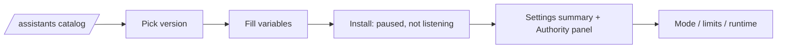
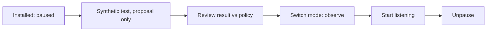
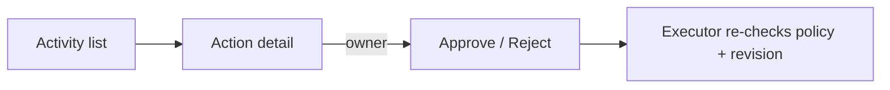

# Assistant Builder UX reference spike (#1280)

Status: PROPOSED research. Refs #1280 (not Closes). Docs only: no UI, runtime,
test, dependency, schema, permission, workflow or activation change. Creating
this document grants no authority and ships no feature. The recommendation in
section 9 is pending the operator's exact-content verdict; nothing is
implemented before that.

Main source SHA inspected: `b341c520d60f516fc6a1ee56514ab9372bfe5f8e`
(`origin/main` at fetch time, 2026-11-14). Every `path:line` below is at that
SHA. No network, vendor login, vendor account or live vendor UI was used.

## 0. Evidence limitations (read first)

This comparison is INCOMPLETE on the vendor side, on purpose.

- The task allowed no network access. The repo holds no vendor material
  (`git grep -i -E 'elevenlabs|elevenagents|affectui|elizaos'` matches nothing
  at the SHA above). Source snapshots were requested from the orchestrator
  (question q-1e7fdbc2); at the time of writing none had arrived.
- Therefore every ElevenAgents, affectUI and elizaOS row in section 3 is
  `UNTESTED`. Nothing in this document is an observed vendor screenshot or a
  verified vendor behaviour. The issue's vendor claims are pointers to look
  at, not findings.
- No statement is made about any vendor's license, React readiness, pricing,
  or feature availability. Those need a snapshot of the upstream README,
  LICENSE and docs, with URL and retrieval date, before they can appear.
- The MCTL side (sections 1, 2, 4-8) is `VERIFIED` against source at the SHA
  above by reading it. Nothing was run; no tests were executed (docs only).

Evidence labels used: `VERIFIED` (read in this repo at the SHA),
`VENDOR-DOCUMENTED` (stated in a vendor snapshot supplied to this task: none
yet), `UNTESTED` (named as a lead only).

## 1. Current server-rendered inventory

Two surfaces exist, both only with `AGENT_ENABLED`
(`internal/config/config.go:390`, `cmd/server/main.go:658`, `:680-681`; the
exact guard expression was not re-derived here, the spec states the same,
`docs/assistants/spec.md:741`).

### 1.1 `/assistants` (public, read-only) - SHIPPED

- Route: `mux.Get("/assistants", web.Assistants(...))`, `cmd/server/main.go:658`.
- Handler: `internal/web/assistants.go:189` `Assistants`; template
  `internal/web/assistants.html`, embedded.
- Data: `assistantinstall.Service.ListCatalog` (`internal/assistantinstall/service.go:641`),
  the same call as the `list_assistants` MCP tool, so page and tool cannot
  disagree.
- Fields shown, from `assistantView` (`assistants.go:33`): Name, Version,
  Title, Description, Lifecycle, Tags, Examples, Variables (name, type,
  required, choices, description, non-secret default), Intents (name,
  description, tier), default Mode, DisclosurePolicy, Limits, per-tier digest
  (`tierSummary`, tiers `auto`, `approve`, `never`, `assistants.go:138`).
  Versions are folded per name (`groupAssistants`).
- Not carried by the view struct, so not renderable: instructions, tools,
  owner, profile paths, install values (`assistants.go:29-32`).
- States: 200 catalog; 503 with `Retry-After: 60` and an explicit
  "unavailable" section when the registry cannot be read, never an empty
  catalog (`assistants.go:186-188`, `:209-226`). `Cache-Control: no-store`.
  CSP is `chromeCSP` (`internal/web/headers.go:45`), which includes
  `script-src 'self' 'unsafe-inline' https://stats.mctl.ai` for the shared
  chrome; the page itself needs no JavaScript.
- No-JS: fully usable; it is a read-only document.

### 1.2 Assistant section of `/telegram/connect/manage` (account) - SHIPPED

- Routes: `POST /telegram/connect/manage/assistant/install` and
  `.../assistant/update`, `cmd/server/main.go:680-681`, behind `manageAuth`
  (local-jwt mode only, `main.go:498`).
- Section template: `manageAssistantSection`, `internal/web/manage_assistant.go:428`.
- View: `buildAssistantSection` (`:115`) from `Service.Current` and
  `CurrentSettings`; `assistantinstall.Settings` (`service.go:782`):
  mode, paused, listening, disclosure_enabled/text, max_autonomous_turns,
  max_msgs_per_minute, max_reply_chars, auto_intents, never_intents,
  working_hours, audience_excludes, only/blocked sender counts, runtime,
  managed_reconsent_required. Install revision shown as `#assistant-revision`.
- Authorization: `account:manage` (`assistantFormGate`, `:159`; refusal 403
  `msgManageCannotChangeAssistant`). CSRF: SameSite=Lax connect-session cookie
  (`manage.go:354`), no new token scheme. Body cap 32 KiB (`:53`). The page's
  CSP has no `script-src` (`manage_notifications.go:7`), so it is no-JS by
  construction and the tests assert that
  (`manage_notifications_test.go:86`).
- Forms, each carrying hidden `expected_revision`:

| Control | Handler | Backend field | Mechanism |
|---|---|---|---|
| Install `<name>@<version>` (one `
` form per catalog version) | `HandleAssistantInstall` `:198` | form `name`, `version`, `value.<var>` | `Service.Apply`, `CommitOptions{ExpectedRevision, SelfService:true}`; spec has `paused`/`listening` omitted so install starts paused, not listening |
| Pause / Unpause | `HandleAssistantUpdate` `:316`, `assistantPatchFromForm` `:357` | `setting=paused`, `value=true\|false` | `Service.PatchWithConsent`, merge patch `{"paused":b}` at `expected_revision` |
| Start/Stop listening | same | `setting=listening` | merge patch `{"listening":b}` |
| Mode select | same | `setting=mode`, `value` in `observe\|guarded\|off` (`:64`) | merge patch `{"mode":m}`; schema decides validity |
| Runtime select + consent checkbox | same | `setting=runtime`, `value` in `own\|managed`, `consent` | `PatchWithConsent`; consent is per call, never stored (`:336-342`) |

- Revision CAS: `expectedRevisionForm` (`:185`) requires a positive integer;
  a missing one answers 400 (`msgAssistantFormStale`); a mismatch answers 409
  with the current revision (`assistantFailure` `:393-396`). `Commit` compares
  `current.InstallRevision` to the expected one (`service.go:341`) and is a
  compare-and-set in the same transaction.
- Failure mapping to status: invalid 422, not found 404, lifecycle/no install
  409, consent required 422, managed disabled 403, managed quota 409,
  catalog unavailable 503, upstream 502 (`:392-415`). Messages never include
  submitted values or `Detail`.
- Never shown or prefilled: values, owner notes, instructions (`:20-22`);
  the page tells the user to use `update_install` for those (`:451`).
- Audit: `auditManage` per submission with the error kind only (`:263`, `:350`,
  `:385`).
- Also: install side effect - actions of earlier revisions are denied as
  cleanup (`Commit` doc, `service.go:325-330`); the revision fence is the
  source of truth.

### 1.3 MCP tools that already carry what the pages do not

`list_assistants` (`internal/mcp/assistant_tools.go:163`), `install_assistant`
(`:275`), `update_install` (`:380`, values, notes, tiers, limits, audience,
schedule, disclosure), `fork_assistant` / `update_fork` / `delete_fork`
(`internal/mcp/fork_tools.go:140,199,241`, behind
`ASSISTANT_FORKS_ENABLED`, `config.go:498`, default false).

### 1.4 Where approvals live today

Agent-action approval is NOT a web page. The owner approves in the Telegram
bot chat: `/mctl approve <code>` and `/mctl reject <code>`
(`internal/agent/control/notifier.go:507`, `router.go:74`;
`executor.Approve`/`Reject`, `internal/agent/executor/executor.go:224,309`).
The only web approval surface in the repo is for broadcasts
(`internal/web/broadcasts.go`), which is unrelated to assistant replies.
Other `/mctl` commands: status, leads, conversations, show, continue, pause,
unpause, assistant, takeover (`router.go:74`).

## 2. Status map: shipped / flagged / proposed / unavailable

| Capability | State | Evidence |
|---|---|---|
| Public catalog page | shipped (needs `AGENT_ENABLED`) | 1.1 |
| Install + pause/listening/mode/runtime on manage page | shipped (needs `AGENT_ENABLED`, local-jwt, `account:manage`) | 1.2 |
| Value / owner-notes / tier / limit editing | MCP only (`update_install`); not on web | `manage_assistant.go:451` |
| Private forks | flagged off by default (`ASSISTANT_FORKS_ENABLED`); observe-only until promotion | `config.go:498`, `policy.go:570-576` |
| Fork promotion to guarded | proposed/unwired: no production caller sets `ForkPromoted` | `policy.go:83-89` |
| Managed runtime | flagged (`ManagedRuntimeEnabled`, `config.go:502`), consent-gated | `manage_assistant.go:405-410` |
| Web approvals queue / activity feed | unavailable (Telegram `/mctl` only) | 1.4 |
| Owner-facing test simulator | unavailable; offline `internal/agenteval` fixtures exist for promotion, not for owners | `internal/agenteval/suite.go:1` |
| "First Message" concept | unavailable: no such field in `CatalogEntry`, definition schema or install; grep for first/greeting/opening finds none in `internal/assistant`, `assistants/`, `docs/assistants` | grep at SHA |
| Connectors, shared memory, plugins/providers | not available to users; owned by other issues; this doc implies none | section 6 |

## 3. Side-by-side (vendor columns are leads only)

Date of MCTL evidence: 2026-11-14, SHA above. Vendor columns: all `UNTESTED`,
no snapshot supplied, no URL was opened.

| Dimension | ElevenAgents (elevenlabs.io/docs/eleven-agents/overview) | affectUI (affectui.com/docs, github.com/flohoeller/affectui) | elizaOS catalog (github.com/elizaOS/eliza) | MCTL today (VERIFIED) |
|---|---|---|---|---|
| Builder shape | UNTESTED | UNTESTED | UNTESTED | catalog page + manage forms; two server-rendered pages; no wizard |
| Prompt / persona authoring in UI | UNTESTED | UNTESTED | UNTESTED | definition authored in repo; owner notes via MCP only; forks via MCP |
| First-message concept | UNTESTED | UNTESTED | UNTESTED | none |
| Test before activate | UNTESTED | UNTESTED | UNTESTED | none for owners; install starts paused and not listening; mode `observe` queues every reply for approval |
| Tool / capability picker | UNTESTED | UNTESTED | UNTESTED | none; tools fixed by definition, fork may take a subset |
| Approval / activity view | UNTESTED | UNTESTED | UNTESTED | Telegram `/mctl` only |
| Component licence, framework | UNTESTED, not stated | UNTESTED, not stated | UNTESTED, not stated | Go `html/template`, no JS on manage page |

The only use of this table is to decide which vendor pages to snapshot next.
No pattern below is claimed to come from any vendor; wireframes are original
and derived from MCTL source.

## 4. Separation the UI must keep

Five things are different and a builder must not blur them:

1. Prompt: definition `instructions` plus the user's `ownerNotes` (spec
   `:186`). Advisory to the model. Never a security boundary.
2. Capabilities: tool subset from the registry, intents declared by the
   definition. Defines what the model may propose.
3. Effective authority: what `policy.Evaluate` returns for a proposed action
   (`internal/agent/policy/policy.go:419`). Server-side, three outcomes:
   Allow, RequireApproval, Deny.
4. Runtime: `own` or `managed` worker; changes who runs the model, not what
   policy allows (`spec.md:788`).
5. Approval: the owner's act on one exact action, bound to its install
   revision. Not a standing grant.

### 4.1 Who controls what (from `spec.md:184-194`, restated)

| Layer | Setter | Examples | Overridable by |
|---|---|---|---|
| Assistant defaults | definition author | default mode, limits, tiers, disclosure policy | account owner within `userOverride` and ceilings |
| Account owner limits | install (`update_install`; mode/pause/listening on web) | turns, msgs/min, chars, working hours, audience, blocked senders | nothing above the author ceilings |
| Non-overridable platform policy | code in `policy.Evaluate` | below | nobody (no mode, budget or approval) |

Platform policy that no setting or approval can change, as written in
`policy.go`: global kill (`:420`); user mismatch (`:430`); install revision
missing or changed (`:439-444`, checked before every other rule so "no
approval can release it"); mode off (`:447`); `never` intents (`:517`); peer
mismatch (`:522`); blank disclosure unless explicitly disabled (`:528`);
empty reply, over-length (disclosure counted), URL, credential-like content
(`:532-561`); a `never` owner-profile field echoed (`:565`); conversation
taken over/closed/paused, blocked sender, excluded audience, superseded
source (`:471-493`); autopilot paused (`:503`).

### 4.2 Allowed automatically / Requires approval / Denied

The three lists in any UI must be computed from the same inputs as
`Evaluate`, not be UI-only switches:

- Allowed automatically: only when mode is `guarded` AND no approval reason
  fires AND no denial fires. Reasons that downgrade to approval
  (`policy.go:615-629`): observe mode (and guarded on an unpromoted fork),
  autonomous turn budget exhausted, intent not in allowlist, rate limit,
  within working hours, working hours unreadable, a protected owner field
  echoed before the owner engaged.
- Requires approval: the above, released only by `/mctl approve <code>` for
  that exact action at the current revision.
- Denied: platform list above. Owner approval cannot release these.

The "budget-exhausted" state is therefore not a denial: it becomes
`RequireApproval`, with owner wording from `OwnerHoldReasons`
(`policy.go:634`), reset by `/mctl continue <id>`.

## 5. Wireframes

Three flows. Each control states its backing field/handler or
`REQUIRES NEW CONTRACT (owner)`. Mobile first (single column, 16 px gutters);
desktop adds a persistent right-hand "Authority" column. All are
server-rendered forms with plain POST + redirect; no client script.

Legend for state tags: `[paused]` `[observing]` `[pending]` `[active]`
`[budget-exhausted]` `[stale-revision]` `[loading]` `[error]` `[empty]`
`[no-JS]`.

### 5.1 Flow A: install and configure

Mobile (390 px):

| # | Block | Content | Backing |
|---|---|---|---|
| 1 | Header | "Assistants", link to catalog | `/assistants` |
| 2 | Card | title, `name@version`, lifecycle, description, tags | `assistantView` |
| 3 | Disclosure | "Starts paused and not listening. It never messages anyone on its own." | install omits paused/listening (`manage_assistant.go:238-241`) |
| 4 | Variables | one labelled input per variable, type-matched (select/number/textarea), required marked, never prefilled | `value.<name>`, `assistantValuesFromForm` |
| 5 | Button | "Install name@version" | `POST .../assistant/install` |
| 6 | Hidden | `expected_revision` | CAS, `service.go:341` |

Desktop (>=960 px): left column = steps 2-5; right column "Authority" read-only
panel, section 5.4.

State annotations:

| State | Rendering | Source |
|---|---|---|
| loading | none: server-rendered, the page is the response; a slow registry is a slow page, then 503 | `assistants.go:201` |
| empty catalog | "No assistants are available to install." | `manage_assistant.go:492` |
| error: catalog | "catalog unavailable", install disabled, `Retry-After: 60` | `:489-491`, `assistants.go:224` |
| error: invalid value | 422, names the variable, not the value | `assistantValuesFromForm` |
| stale-revision | 409: "changed since this page was loaded ... revision N" and current state re-rendered | `:393-396` |
| paused | after install: Paused=yes, Listening=no, "Unpause" offered | `:441-461` |
| no-JS | identical; the page never has script | CSP `manage_notifications.go:7` |
| no permission | forms replaced by the `account:manage` message | `:515-516` |

Control mapping gaps:

| Wanted control | Mapping |
|---|---|
| "Name" / "Description" of a personal assistant | REQUIRES NEW CONTRACT: no owner-editable name or description exist; owner `forks` are MCP-only (owner #1043) |
| Prompt editor | REQUIRES NEW CONTRACT: web never shows or edits `ownerNotes`/instructions by design (`manage_assistant.go:20-22`); owner #1026 for authority UX, #1043 for forks |
| First Message | REQUIRES NEW CONTRACT (owner #1022 definition schema + #1026); see 5.5 |
| Edit variables after install | REQUIRES NEW CONTRACT on web (today MCP `update_install`); install form replaces the whole install |

### 5.2 Flow B: synthetic test, review, activate

Order matches what exists: install (paused, not listening) -> set mode
(`observe` default review posture) -> Start listening -> Unpause. Each is an
existing merge patch. "Activate" in this document means these two existing
toggles, never a new activation endpoint.

Mobile:

| # | Block | Content | Backing |
|---|---|---|---|
| 1 | Status strip | `[paused]` / `[observing]` / `[active]` chip with text, not colour alone | `Settings.Paused/Listening/Mode` |
| 2 | Checklist | "1 Installed  2 Tested  3 Listening  4 Unpaused" | steps 1,3,4 existing; step 2 NEW |
| 3 | Test panel | "Test with sample messages. Nothing is sent." | REQUIRES NEW CONTRACT (owner #1044 evals + #1026) |
| 4 | Result table | sample inbound text, proposed reply, policy outcome Allow/Approval/Deny with `OwnerHoldReasons` wording | outcome computable by pure `policy.Evaluate` (no I/O, `policy.go:59`) |
| 5 | Buttons | Start listening, Unpause, Change mode | existing `update` forms |

Test simulator rules (proposal only):

- Fixtures are synthetic text and synthetic ids (Alice, Bob, Carol, Dana
  personas per `CLAUDE.md`). Never the owner's real conversations.
- It calls no Telegram client and no `propose_reply` endpoint. It would run
  `policy.Evaluate` over a made-up `Input` and, if a model preview is ever
  added, a provider call owned by #1088/#1046, not by this feature. The first
  slice has no model call.
- The result page states "Simulated. Nothing was sent, saved or queued." and
  stores nothing about the sample.
- It must not reuse a job, an action row, an approval code, or the executor.

State annotations:

| State | Rendering |
|---|---|
| paused | simulator still runnable; result row for a reply says `autopilot_paused` denial (Evaluate checks pause, `policy.go:503`), so the table must show the pause as the reason, not hide it |
| observing | every simulated reply = Requires approval (`ReasonObserveMode`) |
| pending | n/a in simulator (nothing queued) |
| active | guarded: some intents Allow, others approval |
| budget-exhausted | simulator can pass `AutonomousTurns >= max` to show `ReasonTurnBudget`; labelled "per-chat" |
| stale-revision | result bound to the revision it was computed at; submit buttons carry `expected_revision`; 409 as 5.1 |
| loading | server-rendered; no spinner needed, button gets "Running..." only with JS (not required) |
| error | "Could not run the test. Nothing was changed." |
| empty | "No sample messages yet. Pick one of the built-in samples." |
| no-JS | whole flow is plain forms |

### 5.3 Flow C: activity and approvals

Today this flow is Telegram only. A web version REQUIRES NEW CONTRACT
(owner #111 operator UI portal / #261 AG-UI for the operator side; account
side belongs to #1026). It must not become a second operator control plane
(section 8).

Mobile (proposal):

| # | Block | Content | Backing |
|---|---|---|---|
| 1 | Header | assistant ref, revision, status chip | `Settings`, `Installed` |
| 2 | Pending list | action id, peer label, proposed text (escaped, truncated), held-for reasons in owner wording | `OwnerHoldReasons`; list endpoint REQUIRES NEW CONTRACT |
| 3 | Buttons | Approve / Reject per action | NEW; must call the same `executor.Approve/Reject` as `/mctl` so the re-check at `executor.go:224` applies |
| 4 | Recent | last N decisions: sent / denied / expired with reason | audit/actions read; NEW read model |
| 5 | Footer | "Pause assistant" | existing `update` form |

State annotations:

| State | Rendering |
|---|---|
| empty | "Nothing is waiting for you." |
| pending | list as above; count in the nav label as text |
| stale-revision | an action whose revision != current is shown as "Written before your assistant changed" with Approve disabled and no form; server still refuses (`/mctl approve` denies and tells owner, `spec.md:231`) |
| budget-exhausted | the held reason "reply budget used up for this chat" plus the existing `/mctl continue <id>` equivalent (NEW if a button; today Telegram only) |
| paused | banner "Paused: replies are withheld"; approvals of already-queued approved actions are still re-evaluated at send |
| error | "Could not load activity. Reload." never an empty list |
| loading | server-rendered |
| no-JS | per-action POST form, redirect back with notice |
| expired | code past TTL shows "expired"; approval refused server-side |

## 6. Ownership and duplicate map

| Concern | Owner | This spike |
|---|---|---|
| Catalog and install (service, registry, MCP) | #1002 | consumes; no change |
| Existing UI (`/assistants`, manage section) | #1022 | extends at most one slice |
| Authority UX | #1026 | primary owner of proposals in 5.1, 5.3 |
| Forks and evals | #1043 / #1044 | owns prompt editing and any real simulator |
| Managed runtime / external runtime | #1088 / #1046 | not touched; runtime is shown, not changed |
| Connectors | #1048 | no connector control implied |
| Shared memory | #309 | no memory control implied |
| Operator UI portal / AG-UI | #111 / #261 | operator plane stays there; no duplicate |
| Voice / WhatsApp | #312 | out of scope |

"Duplicate" check at the SHA: no vendor name appears in the repo; no existing
doc under `docs/reports` covers builder UX. `docs/reports/assistant-runtime-boundary-spike.md`
covers the runtime boundary and was not re-derived. Number references above
come from the task statement; they were not re-verified against GitHub (no
network).

## 7. Accessibility and security review

Accessibility:

- Every status chip carries text (`paused`, `observing`, ...), never colour only.
- One `<label>` per input, as the install form already does
  (`manage_assistant.go:502`); simulator and approval controls the same.
- Use real `<form>`/`<button>`; no div buttons. Tab order = reading order;
  on mobile no fixed bars that cover focused fields.
- Destructive or consequential buttons (Approve, Unpause) are separate from
  neutral ones and name the object: "Approve reply 4F9K2", not "OK".
- Notices use an element with `role="status"` (success) or `role="alert"`
  (error). Today the notice is a plain div (`:430`); small hardening, a
  backlog item.
- Touch targets >= 44 px; text zoom 200 % must not clip a form.
- No-JS is the baseline and the only mode tested.
- Screen reader: tables get `<caption>` and `<th scope>`; the "Authority"
  panel is a `<section aria-labelledby>`.

Security:

- XSS and untrusted preview: simulated and pending reply text is model output
  and sender text. Render only through `html/template` auto-escaping, as the
  existing page does; no `template.HTML`, no markdown, no link auto-detect.
  A reply preview must be plain text, truncated by runes, in a
  `<pre>`/`
` with `white-space: pre-wrap`. Keep `default-src 'none'`
  and no `script-src` on account pages.
- Prompt privacy: the web never renders instructions, `ownerNotes`,
  values or protected owner-profile fields (existing rule). A prompt editor
  would break it; therefore prompt editing stays out of the web slice.
  Logging must not include text previews (redaction handler,
  `internal/audit/redact.go`).
- Cross-user data: every read keys on `id.UserID` from the authenticated
  identity (`manage_assistant.go:124`); no id in the URL or form selects
  another user. A new list/approve endpoint must take the action id and
  verify the action's `user_id` equals the caller's; negative test required.
  Policy already denies a profile/conversation user mismatch (`policy.go:430`).
- Stale approval: approval must go through the executor path that re-runs
  `Evaluate` with the current install revision. A web button that flips the
  row state directly would bypass it and is forbidden.
- CAS: every write carries `expected_revision`; missing -> 400, mismatch -> 409.
- CSRF: same SameSite=Lax connect-session posture; for state changes in a new
  approvals form, add the existing per-form fields only if the notifications
  pattern does (`manage_notifications.go:19-26`); do not invent a token scheme.
- Pause/revoke: Pause must be one tap on every page of the section, and must
  take effect for approvals still queued (policy denies `autopilot_paused`).
  Revoking account access remains the existing disconnect/revoke-client forms.
- First Message: see 5.5.
- Error messages never echo submitted values (`manage_assistant.go:398`).

### 5.5 First Message (defined here, not buildable today)

No such concept exists. If added, it is only the opening line the assistant
may use when REPLYING inside a conversation that the counterpart started. It
must never imply or cause an unsolicited Telegram send: no tool that initiates
a message to a non-participant is added; the UI label is "Opening reply"
rather than "First message", and it is shown only with the sentence "Used only
when someone writes to you first." Whether a definition field is the right
place is a #1022/#1026 decision. REQUIRES NEW CONTRACT (schema change in
`assistants/schemas/*.json`, owner #1022). Recommendation: do not build in the
first slice.

### 5.4 Authority panel (read-only, all flows)

| Group | Content | Backing |
|---|---|---|
| Assistant defaults | default mode/limits/tiers of `name@version` | `CatalogDefaults`, `CatalogIntent` |
| Your limits | mode, turns, msgs/min, chars, working hours, audience, sender counts | `Settings` fields |
| Platform rules (fixed) | list from 4.1, static text | `policy.go` constants; text must be kept in sync by a test (below) |
| Allowed automatically | `AutoIntents` when mode=guarded else "none: observe mode asks you first" | `Settings.AutoIntents`, `Mode` |
| Requires approval | observe, budget, not-on-list, rate, hours | `Reason*` constants |
| Denied | `NeverIntents` + fixed platform list | `Settings.NeverIntents` |

Today the manage section already shows "Replies on its own" and "Never"
(`manage_assistant.go:445-446`) but prints the intent names even in observe
mode, where nothing is auto-sent. That mismatch is the smallest honest
improvement (section 9).

## 8. Constraints honoured

- No second operator control plane: operator views stay under #111/#261.
- No runtime replacement: runtime stays `own`/`managed` selector only.
- No framework migration: no React or component library is proposed; no
  statement about any vendor library's suitability is made (UNTESTED).
- No connector, shared-memory, plugin or provider availability is implied.
- Voice and WhatsApp untouched (#312).

## 9. Outcomes and recommendation

| Outcome | Meaning | Verdict here |
|---|---|---|
| ITERATE_CURRENT_UI | keep server-rendered pages; add small honest slices | RECOMMENDED, pending owner |
| BOUNDED_BUILDER | new multi-step builder (flows A-C) on server-rendered pages | needs new contracts: simulator (#1044/#1026), activity read model, approvals endpoint (#111/#261/#1026) |
| FULL_STUDIO_LATER | prompt editor, tools, memory, connectors in one studio | later; depends on #1043, #1048, #309 |
| DEFER | do nothing | acceptable if the owner prefers |

Recommended: ITERATE_CURRENT_UI. Reason: nearly every wished-for control in
flows A-C maps to REQUIRES NEW CONTRACT owned by another issue, while the
safety-relevant honesty gap is small and local. The vendor comparison cannot
change this until snapshots exist; it is not the basis of the recommendation.
This is a PROPOSAL. The operator's exact-content verdict is required before
any implementation.

### 9.1 The one smallest slice (proposed, no code now)

"Effective authority" block in the existing manage assistant section: group
the already-loaded `Settings` into Allowed automatically / Requires approval /
Denied, with the fixed platform rules, and state plainly that observe mode
auto-sends nothing.

- Provisional files: `internal/web/manage_assistant.go` (view + template
  text), `internal/web/manage_assistant_test.go`. No handler, route, schema,
  store, policy or dependency change.
- Inputs: `assistantinstall.Settings` only; wording for approval reasons from
  `policy.OwnerHoldReasons` (exported already).
- Acceptance tests (red before, green after):
  1. observe mode with `AutoIntents=[discovery]`: page shows "Allowed
     automatically: none" and "every reply needs your approval". Red today:
     page prints "Replies on its own: discovery".
  2. guarded mode: shows the intent under Allowed automatically and lists the
     approval reasons (budget, rate, hours, not-on-list).
  3. `NeverIntents` shown under Denied with "approval cannot release".
  4. Fixed platform list includes install-revision change and kill switch.
  5. Output still contains no values/notes/instructions; no `script` element;
     response CSP unchanged (existing tests keep passing).
  6. Drift guard: a test asserts every `policy.Reason*` constant appears in
     the rendered "Requires approval" text via `OwnerHoldReasons`, so a new
     reason added in policy cannot be missing from the page.
- Meaningful mutations (each must fail a test): render AutoIntents under
  Allowed while mode is observe; drop `NeverIntents` from Denied; drop one
  fixed platform rule; omit the "revision" rule; mark the panel as editable
  (a form control inside it); print DisclosureText unescaped.
- Effort: small (about 0.5 day). Depends on nothing. Risk: copy drift, covered
  by test 6.

### 9.2 Prioritised backlog AFTER the decision (not authorised)

| P | Item | Files (provisional) | Effort | Depends on |
|---|---|---|---|---|
| 1 | Effective authority block (9.1) | `internal/web/manage_assistant{,_test}.go` | S | none |
| 2 | Notice `role` hardening, labels/captions pass | same | XS | 1 |
| 3 | Read-only recent activity list (account scope) | `internal/web/manage_activity.go` (+db read) | M | #1026 contract; cross-user negative test |
| 4 | Synthetic policy simulator (no model, no sends) | `internal/web/manage_assistant_simulate.go`, uses `policy.Evaluate` | M | #1026, #1044 fixtures; pure, no I/O |
| 5 | Web approve/reject via executor | `internal/web/manage_approvals.go` | L | #1026, #111/#261 decision; must call `executor.Approve/Reject` |
| 6 | Opening reply field | schema + web | L | #1022 schema decision |

Acceptance tests for 3-5 follow the same red-before/green-after shape;
mandatory negative guards: another user's action id -> 404 and no write;
stale revision -> refused and no state change; approving a `never` or
install-changed action -> still denied (mutation: bypass `Evaluate` in the
handler must fail a test); simulator performs no store write and no Telegram
call (mutation: call `Propose` must fail).

## 10. What is missing to finish this research

1. Source snapshots (text, URL, retrieval date) of the four upstream
   references; then fill section 3 with VENDOR-DOCUMENTED rows and verify
   licence statements from the actual LICENSE files.
2. Operator confirmation of the issue numbers in section 6 (taken from the
   task text, not re-verified).
3. Optional: a human walk-through of the live pages on a staging account with
   a screen reader, which this spike did not do.

Until (1) is delivered the vendor comparison is explicitly unfinished.
