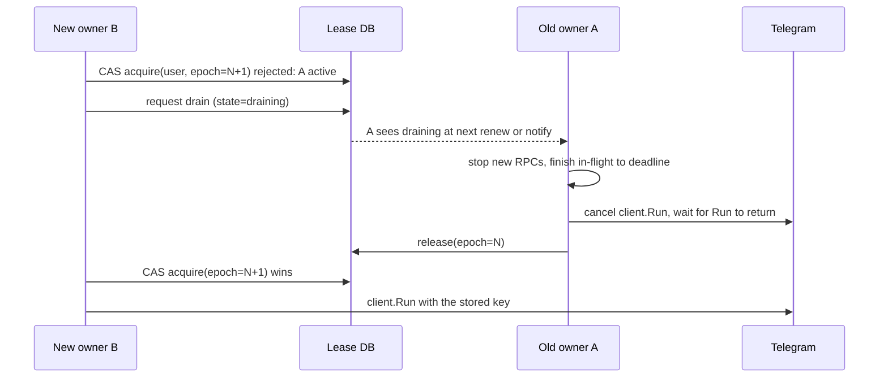

# MTProto scaling architecture spike (#1282)

Status: PROPOSED research. Refs #1282 (not Closes). Docs only: no runtime,
test, schema, config, credential or permission change. Source inspection and
design only. The outcome is pending the owner; merging this file grants no
authority to implement anything in it.

Base: `origin/main` at `d10f33bf4c314e91523596b048abe903d85e1599`. Every
`path:line` below is at that SHA unless another is named.

Labels used throughout: OBSERVED (read in repository source at the SHA),
REPORTED (stated in a repository document, not re-measured here),
VENDOR-PARAPHRASE (the orchestrator's bounded paraphrase of a Telegram page
read on 2026-11-14; not a snapshot), DEP-UNVERIFIED (behaviour of a
dependency's internals; the dependency cache was out of scope, so it was not
read), UNKNOWN, NOT_RUN.

## 1. Scope and limits of this document

- It does not repeat the design already recorded in
  [ADR 0005](../adr/0005-session-pool-and-sticky-routing.md),
  [docs/hpa.md](../hpa.md) and [internal/bridge/DESIGN.md](../../internal/bridge/DESIGN.md).
  It cites them and adds what they leave open.
- No benchmark was run. No Telegram request was made. Every capacity number
  that is not already in a repository document is UNKNOWN or NOT_RUN.
- The issue numbers #1115, #145, #126, #568, #1108 are mapped from the task
  statement. The repository carries text for some of them (section 11); for
  the others the title and state are UNVERIFIED here, and the connector
  evidence the task allows must confirm them before anyone relies on the map.
- Facts about other repositories (mctl-gitops replica count, resource limits,
  probes) are only what this repository's docs say about them. Nothing from
  another checkout was read.

## 2. Evidence the spike rests on

Repository (OBSERVED unless marked):

| Fact | Where |
|---|---|
| One gotd client per `user_id`, in a per-process map, each with `run()` and `gc()` goroutines | `internal/telegram/clientpool.go:109-155,462-515` |
| Pool cap is a count of map entries; 0 means uncapped | `clientpool.go:113,473-477`; `internal/config/config.go:240-241,629` |
| Idle teardown after `IdleTimeout`, checked once a minute; pinned (listener) entries are exempt and heartbeat the DB row | `clientpool.go:596-627` |
| Every `Borrow` does one session-validity SELECT and one `last_used_at` UPDATE, plus a session load on a cold entry | `clientpool.go:253-274,326-329`; `internal/db/store.go:1749-1760,1811-1830`; `internal/telegram/sessionstore.go:27-46` |
| A pooled client can never create an auth key: no active row means `db.ErrNoActiveSession` | `sessionstore.go:17-46` |
| The first loaded row id is pinned for the client's life; revocation is by row id, never by user | `sessionstore.go:61-65`; `clientpool.go:423-460,539-594` |
| `Close`, `RemoveAtomic`, `revokeRejected`, idle GC and `Shutdown` all call `cancel()` and do not wait for `client.Run` to return | `clientpool.go:439-460,637-703,621-625` |
| `acquire` refuses only while `retiring[userID]` is set (async revoke) and counts only entries still in the map | `clientpool.go:466-477,556-575` |
| One shared api_id-wide token bucket (`TG_API_RATE_PER_SEC`, `TG_API_RATE_BURST`), default off, shared with the login client | `cmd/server/main.go:222-252`; `config.go:242-253,630-631` |
| `/healthz` and `/readyz` are the same handler and always return 200 | `cmd/server/main.go:504-505,996-1000` |
| Shutdown: `srv.Shutdown` with a 10 s context, then wait for the broadcast worker; `pool.Shutdown` is a deferred `cancel()` per entry | `main.go:248,940-946`; `clientpool.go:697-703` |
| `ConfirmStore` (10 min TTL, single-shot, in-memory), `MediaStore` (same TTL), `PeerCache` (10 min TTL plus dialog snapshots), all per process | `internal/mcp/confirm.go:12-45`; `internal/mcp/mediastore.go:25-39`; `internal/telegram/peercache.go:10-47` |
| Local Bridge `Hub`: in-process, one connection per user, 100 in-flight calls per daemon, ping every 25 s, 5 s pong deadline; relay rollout makes every daemon reconnect | `internal/bridge/hub.go:49,159-300`; `internal/bridge/DESIGN.md`; `docs/runbook.md:2841` |
| Production strategy is `Recreate` at one replica, required for correctness as well as MTProto | `docs/runbook.md:233-257,3171-3177`; ADR 0005 |
| `AUTH_KEY_DUPLICATED` is classified as a revoked-session code and revokes the loaded row | `clientpool.go:28-36`; `docs/troubleshooting.md:218-232` |
| A preview account was found rejected with `AUTH_KEY_DUPLICATED` after a Deployment-strategy change; a fresh OAuth reconnect cleared it | `docs/reports/communication-agent-c1.md:74-83,150-158` (REPORTED; the cause is not established there) |
| Measured RSS: about 30 MB baseline, about 58 MB at 100 idle sessions, about 2.8 MB per session; 3 MB used for planning | `docs/hpa.md:17-26` (REPORTED; amd64, Go 1.25, idle only) |
| About 40 users in the live-login study window | `docs/runbook.md:3667` (REPORTED) |
| Service availability targets: tool 99.5% (3 h 36 min per 30 days), OAuth 99.9% | `docs/slo.md:156-165` |
| Pool-full and flood-wait metrics exist; the pool cap is currently unset, so saturation is unmonitored | `internal/metrics/metrics.go:736-756`; `docs/hpa.md:120-126` |

Telegram (VENDOR-PARAPHRASE; not observed production behaviour):

- `/api/obtaining_api_id`: `api_id`/`api_hash` authorize an application; one
  `api_id` per phone number is currently issued; the published sample app id
  is for testing and is limited; client abuse is monitored. Nothing in it
  grants or denies fleet capacity or a rate.
- `/api/datacenter`: DC endpoints change and `help.getConfig` lists them; main
  queries go to the closest access point; the config includes `tmp_sessions`.
  This does not by itself define what concurrent use of one permanent key
  means. The exact rule is UNKNOWN until a specific source is read.
- `/api/errors`: errors are structured (numeric code and type); `FLOOD_WAIT_X`
  carries a wait; migration errors exist. No exhaustive rate formula.
- Published limits are incomplete. This document asserts no per-account or
  per-IP exclusivity, designs no rate-limit evasion and proposes no `api_id`
  pooling.

Dependency (DEP-UNVERIFIED): `gotd/td v0.163.0` (`go.mod:12`). How many TCP
connections a `telegram.Client` opens, whether it opens extra connections or
exported authorizations for other DCs or media, and how fast `Run` tears down
after cancel were not read. Section 6 treats these as unknowns to measure.

## 3. Identifiers that must not be conflated

| Term | What it is | Who holds it here | Scaling consequence |
|---|---|---|---|
| `api_id` / `api_hash` | Application credential for the whole deployment | `TG_API_ID`/`TG_API_HASH`, one pair, shared by every pooled client and the login client (`main.go:222-252`) | One shared budget and one abuse-monitoring identity. Adding replicas does not add credentials. Adding credentials is out of scope (no `app_id` pooling) |
| User authorization | A logged-in Telegram account | `telegram_accounts` row, sealed at rest (ADR 0001) | Survives restarts; revoked server-side by the user or Telegram |
| Permanent auth key | Per-DC key from the DH handshake; the authorization is bound to it | Session blob in the row, loaded by `SessionStore.LoadSession` | The unit that must have one live owner. Re-handshake creates a new login visible to the user (ADR 0005, `hpa.md:183-196`) |
| MTProto session (session id and salt) | Logical stream inside a key | Inside the gotd client | Two clients on one key are the case ADR 0005 avoids. Whether a given overlap yields `AUTH_KEY_DUPLICATED`, a new session, or nothing is UNKNOWN (section 6.3) |
| TCP connection | Transport carrying a session | Opened by `client.Run` | Counts against pod fds, memory and egress; not equal to a key or an authorization |
| Media/other-DC connection | Possible additional transport, possibly a different key per DC | DEP-UNVERIFIED | Must be counted per DC in the benchmark, not assumed to be one per user |

`AUTH_KEY_DUPLICATED` is therefore not modeled here as "any two TCPs". The
repository treats it as a terminal revocation signal (`clientpool.go:28-36`)
and has one REPORTED occurrence around a strategy change
(`communication-agent-c1.md:82`). Its exact trigger is UNKNOWN, and the design
below guards against the broader, safer condition "two live clients holding
one key at the same time", which the repository already treats as unsafe.

## 4. Current state, with assumptions

```
HTTP (chi)  --JWT-->  MCP tools --Borrow--> ClientPool{map user_id -> entry}
                         |                        |-- run(): client.Run(ctx)  -> Telegram (TCP/DC)
                         |                        |-- gc():  1/min idle check
                         |-- ConfirmStore, MediaStore, PeerCache (process memory)
                         |-- Hub (local-mode users) --websocket--> user daemon (key on user disk)
DB: telegram_accounts (sealed blob, revoked_at, last_used_at), audit chain
```

State owners (each is lost or duplicated if a second process serves traffic):

| State | Owner today | Failure with 2 processes | Needed for scale |
|---|---|---|---|
| MTProto client per user | `ClientPool.entries` (`clientpool.go:134-142`) | Two clients on one key | One verified owner per user (this spike) |
| Update stream (listener) | gotd `updates.Manager` run by the agent runtime via `entry.runFn`, pinned by `Pin` (`agentruntime.go:84-112`) | Two consumers, or none after a pin is lost | The owner must also own the listener; supervisor reconciles per process |
| Rate limiter, per-user holds | In process (ADR 0005) | Budget multiplied by replicas; holds invisible to the peer | Shared or per-owner, fail closed |
| `ConfirmStore` | In process, 10 min | A confirm on another replica returns not-found | Route by owner, or persist |
| `MediaStore` | In process, 10 min | Same, for `get_media` | Same |
| `PeerCache` / dialog snapshots | In process | Extra resolves only (`peercache.go:10-14`) | Nothing; correctness-neutral |
| Local Bridge `Hub` | In process, one daemon per user | Daemon connected to replica A, call lands on B: `ErrNoDaemonConnected` | Route by daemon connection, or a shared registry |
| OAuth pending flows | In process (ADR 0005) | Callback on another replica fails | Out of this spike's scope; listed for completeness |

Assumptions (stated so they can be corrected):
1. One replica, `Recreate`, as the runbook states; the live replica count and
   limits are not re-verified here.
2. Roughly tens of connected users today (REPORTED about 40 in one study).
   The 500/1000/5000 figures below are planning assumptions, not forecasts.
3. A tool call is bursty and user-driven, not a steady stream.
4. Local Bridge users are a separate population whose key is on their disk;
   they do not consume pool sessions.

Observed gaps that matter before any scale step:
- G1. `/readyz` is `/healthz`: always 200, blind to the database and the pool.
- G2. Teardown is cancel-only. After `Close`, `RemoveAtomic`, a rejected-key
  eviction or idle GC the entry leaves the map immediately, so `acquire` can
  build a replacement while the old `client.Run` is still unwinding. Within one
  process that is a possible brief overlap of two clients on one key
  (inference from the code; how long `Run` takes to stop is DEP-UNVERIFIED).
  The only mutual exclusion is `retiring`, which covers async revoke, not
  eviction. `TelegramClientPoolSize` is decremented at exit
  (`clientpool.go:563-565`), so a transient value above the cap is a usable
  overlap signal.
- G3. `Shutdown` cancels and returns; the process may exit before sockets
  close cleanly. With `Recreate` this is hidden because the new pod starts
  later.
- G4. `ErrPoolFull` counts map entries only, not exiting clients, so it
  under-counts live sockets during churn.
- G5. The shared limiter is per process and defaults off.
- G6. Sticky routing (`deploy/ingress/*`) is a performance hint keyed on an
  unverified JWT payload (`hpa.md:230-247`). It is not ownership.

## 5. Owner lifecycle design (applies to options B and C)

Goal: at most one live client per `user_id` across processes, with
fail-closed behaviour and a bounded, observable overlap window. This section
is design only.

### 5.1 Lease record

One row per user (new table in a later, separately approved change):
`owner_id` (pod identity), `epoch` (bigint, strictly increasing),
`expires_at` (database time, not the pod clock), `state`
(`active | draining | released`). All transitions are compare-and-set on
`(user_id, epoch)` using `now()` from the database.

### 5.2 State machine

```mermaid
stateDiagram-v2
    [*] --> Unowned
    Unowned --> Acquiring: CAS insert/update, epoch+1
    Acquiring --> Active: lease row won; start client.Run
    Acquiring --> Unowned: CAS lost
    Active --> Active: renew before TTL/3 (CAS on epoch)
    Active --> Draining: revoke, rebalance, SIGTERM, or renew failed
    Draining --> Released: in-flight RPCs done or deadline; cancel; Run returned
    Released --> Unowned: row marked released (or expires)
    Active --> Fenced: renew CAS lost / epoch changed
    Fenced --> Released: cancel at once, no new RPC
    Active --> Dead: process dies
    Dead --> Unowned: lease TTL elapses, then a new epoch may start
```



Rules:
- Start a new owner only when the previous lease is `released`, or expired
  plus a grace equal to the worst measured teardown time (section 6.4).
- A holder that cannot renew (database partition, long GC pause, clock skew)
  must self-fence at `expires_at - safety_margin` by its own monotonic timer:
  stop issuing RPCs and cancel the client, without needing the database.
- Every outgoing tool RPC checks "lease still held at local fence time"
  before it starts, and the caller maps a fenced result to a retryable error.

### 5.3 Normal handoff



### 5.4 Failure cases

| Case | What the lease can do | What it cannot do | Missing guard to add before trusting it |
|---|---|---|---|
| Owner dies | Expires after TTL; successor starts after grace | Close the dead pod's socket if the pod is alive but partitioned | Self-fence timer in the owner (5.2) |
| Network partition from DB, Telegram still reachable | Nothing: the holder keeps an open socket | Stop an already-open Telegram socket. PostgreSQL fencing is advisory to the holder, not to Telegram | Self-fence timer strictly shorter than TTL; overlap gauge |
| Clock skew | Use database time for expiry; holder uses a monotonic timer for its own deadline | Make two pod clocks agree | Margin >= measured skew; alert on large renew latency |
| Stale release | CAS on epoch makes a late release by an old epoch a no-op | | Epoch in every write, including the audit row |
| Revoke (user disconnect, `RemoveAtomic`) | Move to draining; `RemoveAtomic` already holds a mutex across the DB revoke | Cancel is not awaited (G2) | Await `Run` exit before `released` |
| Drain on SIGTERM | Mark draining, stop acquiring | Existing `Shutdown` is cancel-only (G3) | Await `Run` exit within the 10 s shutdown budget or record that it did not |
| In-flight RPC at fence time | Fence rejects new RPCs | Recall an RPC already on the wire | Non-idempotent mutations (send, pin) already go through `ConfirmStore` single-shot; the fenced owner must not retry them elsewhere |
| Rollout | Lease keeps ownership single across old and new pods if both run | Replace `Recreate` safely on its own | See section 10, step 3 |

Open observation points that any later implementation must expose, read-only:
overlap gauge (clients per user across pods, from the lease table plus pool
gauge), teardown duration histogram (cancel to `Run` return), renew latency
and failures, fence events, CAS conflicts.

## 6. What a stale lease cannot prevent, and how to bound it

6.1 The lease is a database fact. A Telegram socket opened under an old epoch
stays open until the process cancels it. The only effective stop is local:
the holder's own timer and cancel. Therefore the design is "lease for
coordination, local fence for safety", never "lease for safety".

6.2 Two overlap windows exist even in a clean handoff: the old owner's
cancel-to-`Run`-return time, and the new owner's connect time. Both must be
measured (NOT_RUN) before the grace in 5.2 is chosen.

6.3 What Telegram does on overlap is UNKNOWN from the repository and is not
inferred from vendor text. A single-account, isolated, owner-approved test in
a later wave could observe it; this spike authorizes none.

6.4 Grace value: NOT_RUN. Placeholder policy only: grace is the measured p99
teardown time plus the renew interval; do not hard-code a guess.

## 7. Separate the health and availability planes

| Plane | Question | Today | Needed |
|---|---|---|---|
| Liveness | Is the process alive | `/healthz` 200 | Keep |
| Readiness | May the process receive traffic | `/readyz` identical to liveness (G1) | DB reachable, migrations applied, not draining. Must not depend on Telegram |
| Authenticated MCP availability | Can an authenticated caller list tools and call non-Telegram tools | Covered by tool SLI (`slo.md`) | Unchanged |
| Session availability | Can this user's key be borrowed now | `mctl_sessions_borrow_total` results incl. `no_session`, `flood_wait`, `call_error` | Add `not_owner`, `fenced`, `draining` results |
| Degraded | Service up, some sessions unavailable | Implicit | Explicit: pool full, owner moving, lease store down (read-only tools may continue) |

Readiness must never go false because one user's Telegram session is bad;
otherwise one tenant drains the fleet. Telegram flood waits are session or
account scope, not readiness.

## 8. Options compared

A. Stateless HTTP tier + a single MTProto owner process.
- HTTP replicas hold no keys; they forward Telegram work to one owner over
  an internal RPC. State (`ConfirmStore`, `MediaStore`) lives on the owner, so
  it stays correct. HTTP can scale and roll without touching sockets.
- The owner is still a single point of failure and a rollout blackout for
  Telegram work (relates to #1108). Ceiling is one pod's memory and one egress
  identity. This is the smallest step.

B. Sharded session workers.
- Consistent hash of `user_id` to N workers, each owning its shard's keys,
  stores and listeners. HTTP tier is stateless and routes by owner lookup.
- Ownership by lease (section 5). Scales sockets and memory linearly.
  Costs: a routing tier, a lease store, resharding handoffs, per-worker
  listener supervision, shared or per-shard limiter.

C. Co-located owners + verified routing (HTTP and MTProto in one pod, routed
to the owner pod).
- Fewest moving parts to build from today's binary. Routing is verified by
  the lease, not trusted from a header.
- Sticky routing alone is NOT ownership: it is keyed on an unverified payload
  (`hpa.md:230-247`) and says only where to try first. Ownership is the lease.
  A request that reaches a non-owner must be forwarded or refused with a
  typed retryable error, never served by opening a second client.
- Cost: every pod keeps HTTP and MTProto coupled, so HTTP rollout and session
  handoff are the same event.

| | A | B | C |
|---|---|---|---|
| Removes rollout blackout for non-Telegram HTTP | yes | yes | partly |
| Removes rollout blackout for Telegram work | no | yes (handoff) | yes (handoff) |
| Scales sockets/memory past one pod | no | yes | yes |
| Needs lease and fence | no (one owner) | yes | yes |
| Moves `ConfirmStore`/`MediaStore` | no | yes, per shard | yes, per owner |
| Keeps Local Bridge custody | yes | yes, bridge sessions stay off the pool | yes |
| Build size | smallest | largest | middle |

Local Bridge custody is preserved in all three: a `mode='local'` user's key
is on their machine, the pool never opens it (`DESIGN.md`; `server.go:65-75`),
and the owner abstraction applies only to `hosted` users. The `Hub` has the
same one-process limit and needs its own decision (route by daemon
connection) before any HTTP fan-out in A or C; this spike does not move it.

## 9. Capacity: assumptions versus measurements

No new measurement exists. REPORTED: 2.8 MB per idle session
(`hpa.md:17-26`).

| Scenario | Connected users (assumption) | Concurrently live clients (assumption, not measured) | Memory at 3 MB planning figure | Verdict |
|---|---|---|---|---|
| 500 | 500 | UNKNOWN | about 1.5 GB if all live | The 1 GiB tier cap of 270 would bind (`hpa.md:30-34`); idle GC lowers live count by an unmeasured amount |
| 1000 | 1000 | UNKNOWN | about 3 GB if all live | Exceeds the largest documented tier |
| 5000 | 5000 | UNKNOWN | about 15 GB if all live | Not one pod under any documented tier |
| Pinned listeners | Subset | Always live | Counts in full | Listener users do not idle out |

The product of users and 3 MB is an upper bound on a stated, unmeasured
assumption, not a prediction. Idle-only RSS also ignores active-call memory,
media buffers (a 768Mi stopgap exists, `runbook.md:3499`), update-stream load
for listeners, and gotd extra-DC state.

| Dimension | Known | UNKNOWN / NOT_RUN |
|---|---|---|
| Sockets per DC | Not observed | Sockets per client, per DC, media vs main, at 100/500/1000 live (DEP-UNVERIFIED) |
| Memory | 2.8 MB idle (REPORTED) | Under active calls, listeners, media, at 500+ |
| Goroutines | Two per client by construction (`clientpool.go:512-513`); gotd adds more (DEP-UNVERIFIED) | Total per live client |
| CPU | | Handshake CPU per cold start; steady-state per call |
| Bursts and fairness | One global mutex `p.mu` guards the map and is held during the DB revoke in `revokeRejected` and `RemoveAtomic` | Mutex contention at burst; one tenant's DB stall blocking others |
| Lease DB amplification | Today: 2 DB statements per `Borrow`, plus a pin heartbeat per minute per listener | Added renew traffic: roughly one write per live client per renew interval; unquantified at 1000+ against a pool of 10 open connections (`db.go:50-56`) |
| Egress and login throttling | Shared limiter exists, default off | Real rate that triggers `FLOOD_WAIT`; login burst behaviour (`runbook.md:2530-2535` notes a login burst can flood-wait the shared id) |
| Latency, success | SLO targets only | Cold-start and handoff latency; success during handoff |
| Headroom cost | | Cost of redundant or standby capacity |

## 10. Recommendation

Smallest zero-downtime step first, then a separately gated scale path. All of
it needs later owner approval; none of it is authorized by this document.

Step 0 (read-only, no behaviour change): instrument and decide.
- Make `/readyz` distinct from `/healthz` (DB reachable, not draining).
- Add read-only metrics: clients per user (should be 0 or 1), pool size above
  cap (overlap), cancel-to-`Run`-return duration, socket and goroutine counts
  per client, DB statements per Borrow.
- Capture the measurements in section 9 as telemetry from the existing single
  replica. This turns the UNKNOWN cells into data without a load test.

Step 1 (smallest zero-downtime change): option A for HTTP only. Keep one
MTProto owner and `Recreate` for it, but split a stateless HTTP tier so that a
web/OAuth/static rollout no longer blacks out the service. This does not
change key ownership and does not touch `api_id`. It addresses the part of
#1108 that is not Telegram work.

Step 2 (gated on step 0 data and an owner decision): fix the teardown gaps G2
and G3 in the single owner: await `Run` exit before an entry is considered
gone and before `acquire` may rebuild, and make `Shutdown` wait within its
budget. This is a prerequisite for any lease, and is useful alone.

Step 3 (separately gated scale path): lease, epoch and local fence (section
5), then option C for co-located owners with verified routing, because it
reuses the existing binary and the sticky manifests as a hint only. Move to
option B only if step 0 data shows one pod's memory or one egress identity is
the limit. Replace `Recreate` last, only after the overlap gauge has stayed at
zero under a handoff test the owner approves.

### Counter-evidence and no-go conditions

- The REPORTED `AUTH_KEY_DUPLICATED` occurrence shows that a strategy change
  alone coincided with a dead preview session; any step that allows overlap
  must be rolled out with the overlap gauge as a stop signal.
- No-go for steps 3 and beyond if: teardown time is unbounded or unmeasurable;
  the overlap gauge is non-zero in a controlled handoff; the lease store is
  not on the readiness path; a request can be served by a non-owner.
- No-go for any design that depends on additional `api_id`s, per-IP spreading
  to avoid limits, or a claimed exclusivity not shown in a primary source.
- If a primary source later shows a stricter concurrency rule for a key, only
  the grace and fence margins change; the lease design stays.

### Rollback

- Step 0 and 1: revert the change; behaviour returns to one pod, `Recreate`.
- Step 2: revert; teardown returns to cancel-only.
- Step 3: set owners back to one holder (lease table ignored), restore
  `Recreate`, stop the new revision before starting the old one as the
  runbook requires (`runbook.md:253-254`). Pending confirmations may be lost
  (`confirm.go:17-20` already says this is by design).

## 11. Existing issue dependency map

| Issue | Role here | Source of the claim |
|---|---|---|
| #1115 lease/fencing | Section 5 and 6 | Task statement; no repository text at the SHA |
| #145 and #126 routing | Sticky ingress reference manifests (`hpa.md:203-204`: #141 closing #126); #145 not found in the repository | Partly OBSERVED, #145 UNVERIFIED |
| #568 statelessness | Retiring the legacy MCP session path is a code change that belongs to #568 | `docs/cloudflare-portal-compat.md:68,180`; `internal/mcpprobe/inprocess_test.go:217-228` |
| #1108 rollout blackout | DB connect retry shortened to cut rollout dead time; Telegram-work blackout remains | `cmd/server/main.go:70-76`; `docs/plans/gate-889-managed-soak.md:75-76` |
| #1282 | This spike | Task statement |

Ordering: step 0 has no dependency; step 1 depends on #568 (statelessness of
the HTTP tier); step 2 is a prerequisite of #1115; step 3 depends on #1115
and on #145/#126 routing; #1108 is reduced by step 1 and closed only by step 3.

## 12. Provisional implementation allowlist, tests and mutations

Provisional only. No new epic, child issue or contract is approved by this
document; the owner decides whether any of it becomes work.

Files a later change would likely touch:
- `cmd/server/main.go` (readiness, shutdown wait)
- `internal/telegram/clientpool.go` (await `Run` exit, owner gate)
- new `internal/telegram/lease*.go` and a schema addition in `internal/db`
- `internal/metrics/metrics.go` (read-only gauges and histograms)
- `internal/mcp/server.go`, `confirm.go`, `mediastore.go` (owner-aware state)
- `docs/hpa.md`, `docs/runbook.md`, ADR 0005 supersession note

Tests a later change would need: lease CAS races (two acquirers, stale
release, epoch bump); self-fence at TTL without DB; teardown-awaited before
rebuild; `acquire` blocked while an old `Run` is unwinding; readiness false
on DB loss and true on Telegram loss; confirm/media routed to the owner;
Local Bridge users never entering the lease path.

Mutations a later change would perform: add one lease table; add metrics;
change `Recreate` only at step 3. No schema, config or secret change is
made by this spike.

## 13. Proposed isolated benchmark and read-only telemetry (needs later approval)

Nothing below is run or authorized now.

Read-only telemetry on the existing replica (step 0): the metrics in
section 10, plus process fd count, goroutine count, `p.mu` wait, DB statements
per Borrow, and pool size over time. No new Telegram traffic.

Isolated benchmark (later approval, owner-chosen accounts and environment):
- Use the repository's synthetic personas for fixtures; no real account id in
  committed files.
- Phase 1: idle sockets, memory, goroutines at 10/50/100/250 live clients
  against a Telegram test environment if one is approved, otherwise a fake
  transport; report per-DC sockets.
- Phase 2: handoff test for one test account only: measure cancel-to-`Run`
  return, and observe what Telegram returns during a deliberately bounded
  overlap. Abort on the first `AUTH_KEY_*` signal.
- Phase 3: DB amplification with a lease table at 500/1000 simulated holders.
- Report UNKNOWN/NOT_RUN for anything not run. No result becomes a capacity
  claim without the raw numbers attached.

## 14. Evidence gaps and pending decisions

Evidence gaps:
1. Exact Telegram rule for concurrent use of one permanent key (UNKNOWN; needs
   a specific source on `/api/auth` and `/api/datacenter` beyond the excerpts).
2. gotd connection model, per-DC key use and teardown time (DEP-UNVERIFIED;
   cache not read).
3. Live replica count, limits and probes in mctl-gitops (needs connector
   evidence).
4. Titles and state of #1115, #145, #568 beyond what the repository carries.
5. Whether Telegram's `FLOOD_WAIT` budget is per account, per `api_id` or per
   IP for this workload (UNKNOWN).

Pending owner decisions:
1. Is step 0 telemetry approved to run on the existing replica?
2. Is the HTTP/MTProto split (step 1) wanted before the lease work, or is the
   `Recreate` blackout accepted at current SLO targets?
3. Is a Telegram test environment or single test account approved for the
   handoff observation in section 13?
4. Does the Local Bridge `Hub` need its own owner design now, or is it
   deferred?
